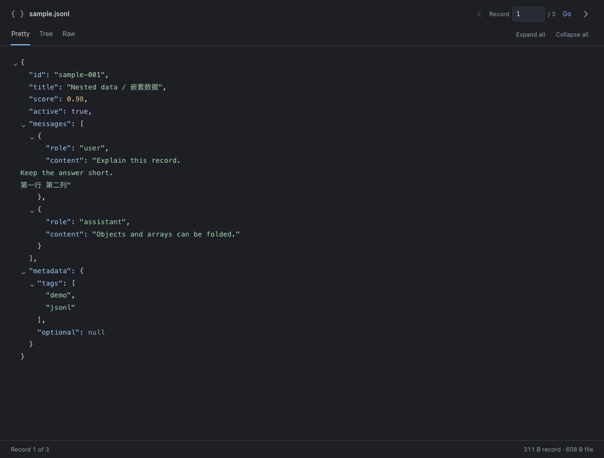

<div align="center">
  
  <h1>JSONLine Viewer</h1>
  <p><a href="README.md">English</a> | <strong>简体中文</strong></p>
  <p><strong>一次专注一条记录，让大文件也易于阅读。</strong></p>
  <p>用于查看 <code>.jsonl</code> 和 <code>.ndjson</code> 文件的只读 VS Code 扩展。</p>
  <p>
    
    
    <a href="LICENSE"></a>
  </p>
</div>



*截图来自实际预览界面，使用虚构的示例数据。*

## 为什么选择 JSONLine Viewer？

- **清爽的阅读界面。** 透明底色、轻量阅读面板、清晰的 JSON 配色和紧凑的记录导航工具栏，同时支持浅色与高对比度主题。
- **默认使用 Pretty 视图。** 打开记录即可查看语法高亮后的 JSON，字符串中的换行和制表符会显示为实际空白。
- **跟随光标与编辑。** 在源文件中切换行或修改记录，预览会同步更新，也支持尚未保存的修改。
- **浏览大文件。** 首次建立字节偏移索引，随后只读取选中的记录，无需将整个文件保留在内存中。
- **按需切换视图。** Pretty 适合阅读，Tree 支持折叠对象，Raw 保留原始行内容。
- **单条错误不影响浏览。** 格式有误的记录会显示解析错误，你仍可继续查看其他行。

## 快速开始

安装扩展后：

1. 打开 `.jsonl` 或 `.ndjson` 文件。
2. 将光标放在需要查看的记录上。
3. 点击编辑器右上角工具栏中的 **Preview**（预览）图标。

**Pretty** 预览会在源文件旁打开。使用**上一条 / 下一条箭头**切换记录，或在 **Record** 输入框中填写记录序号，再点击 **Go** 跳转。

如果想浏览大文件而不将其作为文本打开，可在命令面板运行 **JSONLine Viewer: Open File**。扩展会先扫描一次文件建立索引，再打开 Pretty 视图。扩展不会向资源管理器右键菜单添加入口。

### 试用示例

将下面这条单行记录保存为 `sample.jsonl`，然后点击 **Preview**：

```json
{"id":"sample-001","score":0.98,"is_reasoning":true,"messages":[{"role":"user","content":"Explain this record.\nKeep the answer short."}],"metadata":null}
```

Pretty 会将 `content` 字符串显示为两行。切换到 Raw 可查看原始的 `\n` 转义序列。

## 视图说明

| 视图 | 适用场景 |
| --- | --- |
| **Pretty** · 默认 | 阅读经过缩进和语法高亮的 JSON，字符串中的换行和制表符按实际空白显示 |
| **Tree** | 展开或折叠对象与数组 |
| **Raw** | 查看未经修改的原始记录，包括 JSON 转义序列 |
| **Native JSON Preview** | 使用 VS Code 原生 JSON 编辑器的折叠、括号匹配、诊断和查找功能 |

在源文件处于活动状态时运行 **JSONLine Viewer: Native JSON Preview**。可通过编辑器标题栏中的箭头和 **Go to Row** 命令切换记录；状态栏会显示当前记录序号和总数。

## 从源码安装

开发需要 **Node.js 20+**，运行扩展需要 **VS Code 1.85+**。

```bash
npm ci
npm run package
code --install-extension ./large-jsonl-viewer.vsix --force
```

打包命令会编译扩展、运行测试，并生成 `large-jsonl-viewer.vsix`。安装后请重载 VS Code 窗口。

**Remote SSH：** 请将 VSIX 安装到已连接的远程环境，使扩展运行在文件所在的主机上，然后重载该窗口。

## 开发

```bash
npm run compile
npm test
```

测试覆盖 LF/CRLF 换行索引、空文件，以及总大小超过 50 MiB、单条记录超过 1 MiB 的生成文件。DOM 测试覆盖语法高亮、字符串空白显示、Raw 原文保留、视图切换、记录导航、无效 JSON，以及大记录中类似 HTML 的字符串。

## 使用限制

- 所有视图均为只读，仅支持基于文件系统的 `file:` URI，包括 Remote SSH 扩展主机上的文件路径。
- 建立索引的耗时与文件大小成正比，索引内存占用随行数增长；切换记录时只读取目标记录。
- Pretty 会将字符串中的空白转义显示为实际空白。需要未经修改的 JSON 原文时，请使用 **Raw**。

## 许可证

[MIT](LICENSE)
