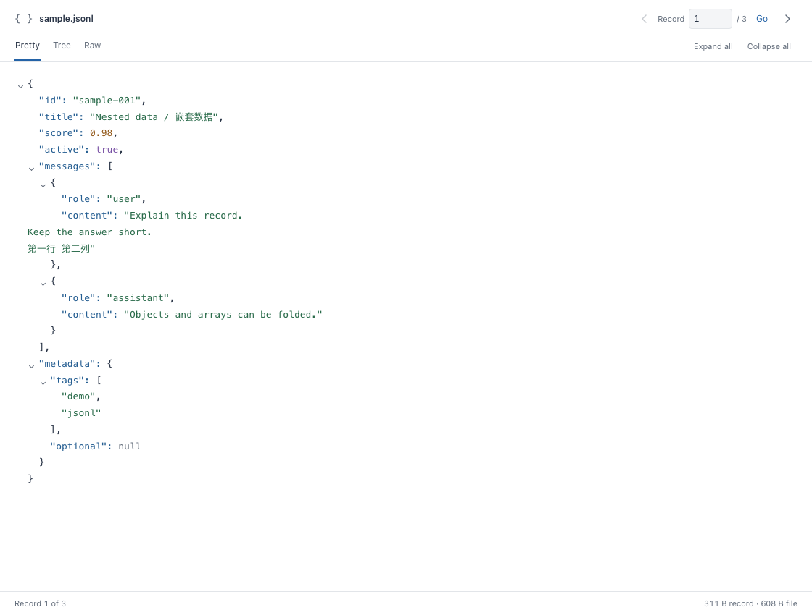

<div align="center">
  
  <h1>JSONLine Viewer</h1>
  <p><a href="README.md">English</a> | <strong>简体中文</strong></p>
  <p><strong>一次专注一条记录，让大文件也易于阅读。</strong></p>
  <p>用于查看 <code>.jsonl</code> 和 <code>.ndjson</code> 文件的只读 VS Code 扩展。</p>
  <p>
    
    
    <a href="LICENSE"></a>
  </p>
</div>

| 深色 | 浅色 |
| --- | --- |
|  |  |

*截图由 [examples/sample.jsonl](examples/sample.jsonl) 中的虚构记录渲染生成。*

## 开始试用

1. 在 VS Code 中打开 [examples/sample.jsonl](examples/sample.jsonl)，也可使用自己的 `.jsonl` / `.ndjson` 文件。
2. 将光标放在一条记录上，点击编辑器工具栏的 **Preview**，或在命令面板运行 **JSONLine Viewer: Preview**。
3. 在侧边预览中阅读。移动源文件光标、使用上一条／下一条箭头，或输入 **Record** 序号并点击 **Go** 切换记录。

预览会跟随源文件编辑同步更新，包括未保存的修改。文件的每个物理行是一条独立 JSON 记录。

示例文件包含三条记录：

| 记录 | 试用内容 |
| --- | --- |
| 1 | 折叠 `messages` 或 `metadata`，在 Pretty 中阅读多行中英文文本。 |
| 2 | 展开嵌套数组，查看空对象、空数组和字面量 `\n`。 |
| 3 | 切换 Raw，查看原样保留的空白、重复键、大整数和指数记法。 |

示例内容均为虚构，不包含凭据或个人数据。

## 视图与操作

| 视图 | 用途 |
| --- | --- |
| **Pretty** · 默认 | 缩进、语法高亮的 JSON；对象和数组可折叠，字符串中的换行和制表符显示为实际空白。 |
| **Tree** | 以可展开的字段浏览对象和数组。 |
| **Raw** | 高亮显示原始文本，保留空白、转义、重复键和数字精度。 |
| **Native JSON Preview** | 使用 VS Code 原生 JSON 编辑器的折叠、括号匹配、诊断和查找功能。 |

- **折叠：** Pretty 和 Tree 支持逐级操作及 **Expand all / Collapse all**。同一条记录内切换视图时，各视图保留自己的折叠状态。
- **无效记录：** Pretty 和 Tree 显示解析错误，Raw 仍可查看原文，也可继续切换记录。
- **原生预览：** 源文件编辑器处于活动状态时，运行 **JSONLine Viewer: Native JSON Preview**，通过其标题栏箭头或 **Go to Row...** 导航。
- **外观：** 自动跟随 VS Code 的深色、浅色及高对比度主题，切换后立即生效。紧凑工具栏集中导航与折叠操作，记录详情放在底部。

Pretty 和 Tree 展示解析后的 JSON；需要精确保留原始表示时，请使用 Raw。

## 浏览大文件

运行 **JSONLine Viewer: Open File**，无需先在文本编辑器中打开整个文件。

- 扫描一次建立字节偏移索引，之后切换记录只读取目标行。
- 索引耗时随文件大小增长，索引内存随行数增长，渲染内存取决于当前记录的大小。
- 所有视图均为只读，支持基于文件系统的 `file:` URI，包括 Remote SSH 主机上的文件。

## 构建与安装

构建需要 **Node.js 20+**，运行需要 **VS Code 1.85+**。

```bash
npm ci
npm run package
code --install-extension ./large-jsonl-viewer.vsix --force
```

安装后运行 **Developer: Reload Window**。在本机打开示例：

```bash
code examples/sample.jsonl
```

使用 **Remote SSH** 时，将 VSIX 安装到已连接的远程环境，再重载该窗口。扩展需要运行在文件所在的主机上。

## 开发

| 命令 | 作用 |
| --- | --- |
| `npm run compile` | 检查类型并编译到 `dist/`。 |
| `npm test` | 编译并运行索引和预览行为测试。 |
| `npm run package` | 清理、编译、测试并生成 `large-jsonl-viewer.vsix`。 |
| `npm run clean` | 删除生成的构建和安装包产物。 |

## 许可证

[MIT](LICENSE)
